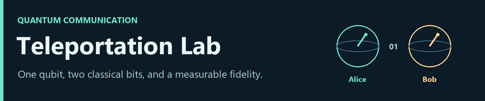
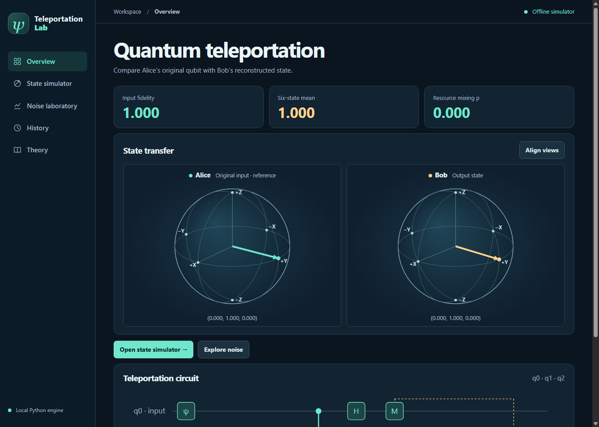

# Quantum teleportation and communication

**How well can Bob recover Alice’s qubit when their entangled pair and their classical message are imperfect?** Choose a state, introduce noise, and see the answer as an arrow on Bob’s Bloch sphere and a fidelity score. A score of **1** means Bob recovered the input exactly.

**[Download Teleportation Lab for Windows ↓](https://github.com/Tapesh001/Quantum-Teleportation-and-Communication-./raw/refs/heads/main/downloads/Quantum_Teleportation_Animated.zip)** · [First experiment](#a-result-to-reproduce) · [Research paper](#from-the-paper-to-the-project) · [Code by project part](docs/code-map.md)

## Open the software

1. Install Python 3.8 or newer and have a modern desktop browser available.
2. Download the ZIP above and **extract all files**.
3. On Windows, double-click **Launch_Model.cmd**. Your default browser opens the lab. Keep the launcher window open during your session and press Ctrl+C there to stop the local server.

From a checkout or an extracted ZIP you can also run:

```bash
python run.py
```

The terminal prints the local address if the browser does not open automatically. The application uses standard-library Python, local HTML, CSS and JavaScript. No package installation, cloud account or internet connection is needed for simulation.

## Inside the lab



*Alice’s arrow records the input. Bob’s arrow shows the calculated output. Click **Align views** to compare their lengths and directions.*

### Choose a page

| Page | What you can investigate |
| --- | --- |
| **Overview** | See input fidelity, six-state mean, resource mixing and the teleportation circuit. Alice’s reference and Bob’s output have their own labeled Bloch spheres. |
| **State simulator** | Set θ, φ, resource mixing p, per-bit error e and Bob’s corrections. Inspect the density matrix and the possible received messages given Alice’s measured bits. |
| **Noise laboratory** | Animate a 101-point resource-noise sweep, compare independent and perfectly linked errors, and export both models to CSV. |
| **History** | Browse saved settings and results, newest first. Browser and desktop interfaces use the same local SQLite journal. |
| **Theory** | Start here if you are new to quantum physics. Follow one message through the protocol, read the evidence from the 1997 experiment, then reproduce the report’s noise results. |

## A result to reproduce

In **Noise laboratory**, select **Try 10% comparison**. This prepares |1⟩ with an ideal Bell pair and a 10% error rate per classical bit. Press **Start sweep** to increase p while the other settings stay fixed.

| At p = 0 and e = 0.10 | Independent flips | Linked flips |
| --- | ---: | ---: |
| Neither bit flips | 81% | 90% |
| Both bits flip | 1% | 10% |
| Input fidelity for the chosen state | 0.900 | 0.900 |
| Mean across the six test states | 0.873333 | 0.933333 |

> **What the result tells you:** Testing only the chosen input gives the same score for both error patterns. The six-state average reveals a difference because the other input states respond differently to those errors.

Move the pointer across the noise graph to preview both mean fidelities at any resource setting. The gold dot marks the calculated experiment. Each point in a sweep is a separate calculation. The rotation of Bob’s sphere changes the camera angle. Select **Align views** to compare both vectors from the same angle.

## From the paper to the project

Bouwmeester and colleagues used photon polarization to demonstrate teleportation conditioned on a selected detector event. Figure 5 reports **70% ± 3% visibility**, the contrast of a coincidence dip. Our project asks a follow-up question in software: when all four measurement outcomes are included, how does the fidelity change as the pair and message become noisier? [Read the original Nature paper (1997)](https://doi.org/10.1038/37539).

With independent 10% bit errors, increasing resource mixing from **0.20** to **0.60** lowers the six-state mean from **0.798667** to **0.649333**. Those two settings fall on opposite sides of the **2/3 classical benchmark**. The in-app **Theory** page explains the benchmark and shows how to reproduce the report’s values. [Model assumptions and references](docs/science.md).

## Repository

| Directory | Contents |
| --- | --- |
| [frontend](frontend/) | Responsive browser workspace, circuit, Bloch spheres and charts |
| [backend](backend/) | Numerical engine, local HTTP service, history and CSV calculations |
| [desktop](desktop/) | Optional Tkinter lab and history viewer, using the same backend engine |
| [tests](tests/) | Reproducible numerical checks |
| [docs](docs/) | Model assumptions, references, part-by-part code guide and interface screenshot |
| [scripts](scripts/) | Build the downloadable offline package |
| [downloads](downloads/) | Ready-to-extract project ZIP |

Run the checks with `python -m unittest discover -s tests -v`. To launch the optional Tk interface, use `python desktop/teleportation_model.py`. Desktop inputs, results and corrections follow the same model as the browser interface.

The layout takes inspiration from the [reference workspace](https://github.com/SatyaSailesh/quantum-teleportation). The noise models and calculations are those of this quantum communication project.
